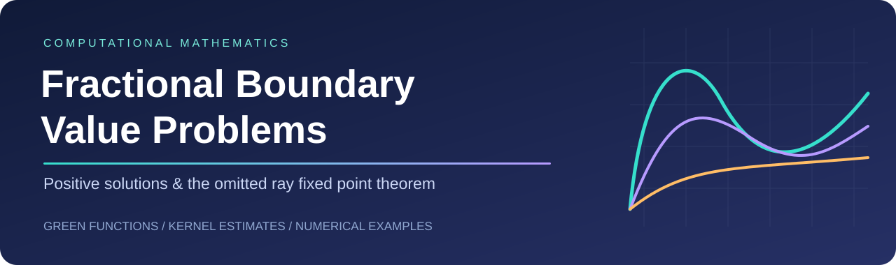
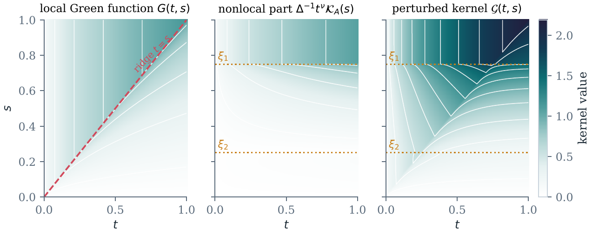
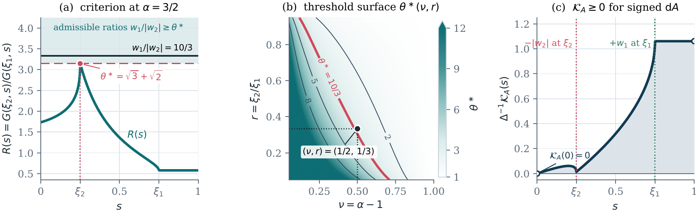
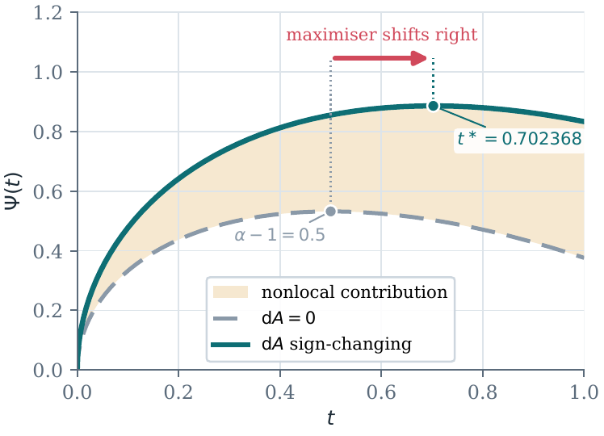
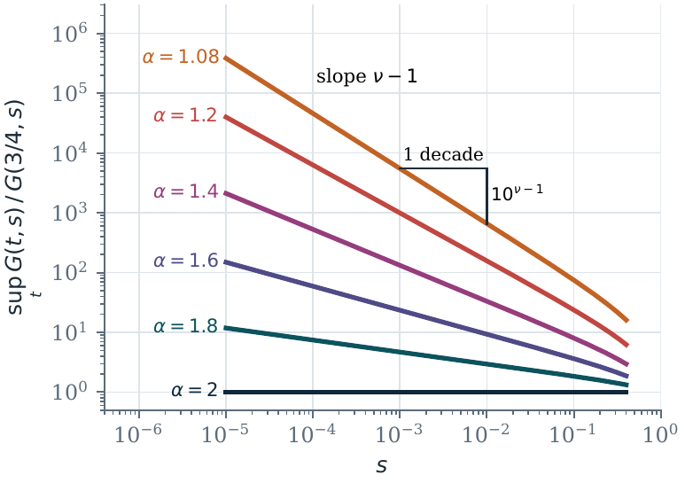
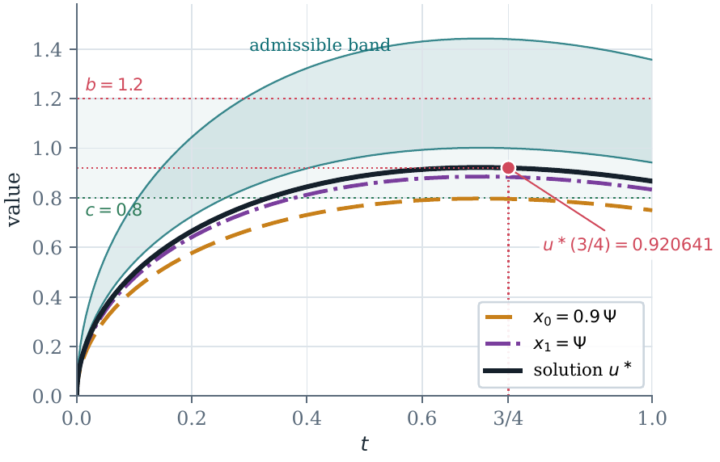
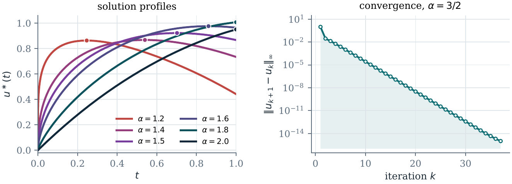
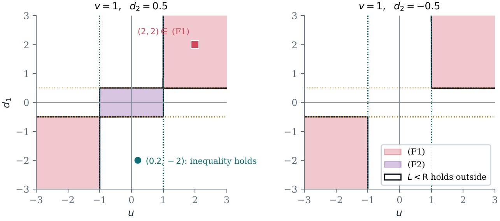
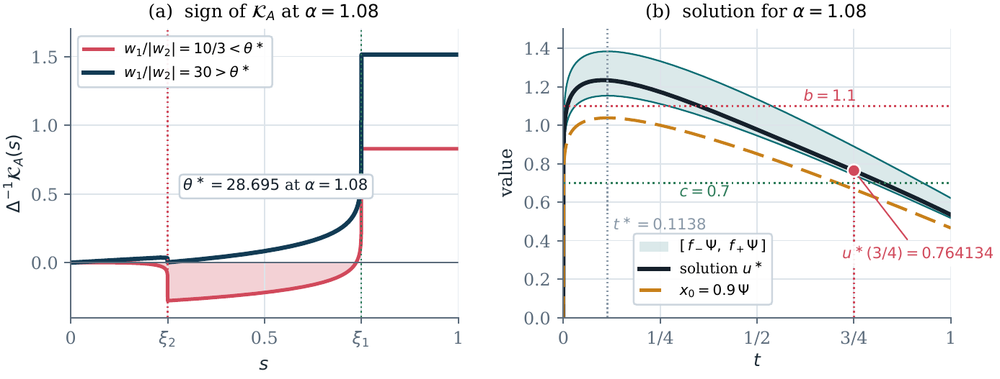

<p align="center"></p>

<h1 align="center">🧮 Omitted Ray · Fractional BVP</h1>
<p align="center"><strong>Green functions • Positive solutions • Reproducible computations</strong></p>

<p align="center">
  
  
  
  
</p>

<p align="center"><a href="#research">Research</a> · <a href="#gallery">Figure gallery</a> · <a href="#reproduce">Quick start</a> · <a href="#reference">Code &amp; citation</a></p>

<a id="research"></a>


## 🔬 Research overview

Computational companion to:

> **Positive Solutions of a Fractional BVP and the Reach of the Omitted Ray Fixed Point Theorem**  
> M. Khuddush and S. S. Almuthaybiri · Manuscript

The model combines a fractional differential equation with a nonlocal boundary condition involving a Riemann–Stieltjes measure that may change sign:

$$
D^\alpha u(t)+f(t,u(t))=0,\qquad 0<t<1,\quad 1<\alpha\leq2,
$$

$$
u(0)=0,\qquad D^\nu u(1)=\int_0^1 u(\tau)\,dA(\tau),\qquad \nu=\alpha-1.
$$

| 🟦 Green functions | 🟪 Positivity | 🟩 Numerical solutions |
| :--- | :--- | :--- |
| Local kernel, nonlocal correction and perturbed kernel | Weight-ratio thresholds and kernel estimates | Product integration, fixed-point iteration and mesh refinement |

The repository includes source code, stored results, LaTeX table fragments and eight PDF figures. **The manuscript source and manuscript PDF are not included.**

<a id="gallery"></a>


## 🎨 Explore the figures

The previews below are rendered from the supplied PDF figures. Select **Vector PDF** for the original figure.

### 01 · Green-function channels



[📄 Vector PDF](figures/fig1_channels.pdf) · [🔍 Full-size preview](figures/previews/fig1_channels.png)

### 02 · Positivity and signed boundary weights



[📄 Vector PDF](figures/fig2_positivity.pdf) · [🔍 Full-size preview](figures/previews/fig2_positivity.png)

### 03 · Nonlocal shift of the profile maximum



[📄 Vector PDF](figures/fig3_psi_shift.pdf) · [🔍 Full-size preview](figures/previews/fig3_psi_shift.png)

### 04 · Dependence of the kernel ratio on fractional order



[📄 Vector PDF](figures/fig4_harnack.pdf) · [🔍 Full-size preview](figures/previews/fig4_harnack.png)

### 05 · Solution localisation



[📄 Vector PDF](figures/fig5_localisation.pdf) · [🔍 Full-size preview](figures/previews/fig5_localisation.png)

### 06 · Solution profiles and iteration convergence



[📄 Vector PDF](figures/fig6_solutions.pdf) · [🔍 Full-size preview](figures/previews/fig6_solutions.png)

### 07 · Geometry of the failure set



[📄 Vector PDF](figures/fig7_failureset.pdf) · [🔍 Full-size preview](figures/previews/fig7_failureset.png)

### 08 · A fractional order close to one



[📄 Vector PDF](figures/fig8_example2.pdf) · [🔍 Full-size preview](figures/previews/fig8_example2.png)

<a id="reproduce"></a>


## 🚀 Quick start

From the repository folder, create a separate Python environment:

```bash
python3 -m venv .venv
source .venv/bin/activate
python -m pip install -r requirements.txt
python scripts/make_all.py --quick
```

For all computations, including the two slower checks:

```bash
python scripts/make_all.py
```

To rebuild only the PDF figures from saved results:

```bash
python scripts/make_figures.py
```

To refresh the README previews afterwards, install Poppler and run:

```bash
brew install poppler  # macOS, with Homebrew installed
bash scripts/export_previews.sh
```

Each script can also run independently. The `--quick` option skips `box_scan` and `check_characterisation`. Numerical checks support reproducibility; they do not replace the analytical proofs.

<a id="reference"></a>


## 🗂️ What reproduces what

| Paper item | Script | Output |
|---|---|---|
| Constants of Examples 1 and 2, checks of (E1)-(E4), Table 3 | `scripts/compute_constants.py` | `results/constants.json`, `results/table_constants.tex` |
| Numerical solutions, Tables 7, 8, 9 (mesh refinement) | `scripts/solve_examples.py` | `results/solutions.json`, `results/table_solutions.tex`, `results/table_example2.tex`, `results/table_refinement.tex`, `results/solution_*.npz` |
| Tables 4, 5, 6 (Lemma 8, Lemma 5, Proposition 1) | `scripts/check_lemmas.py` | `results/lemmas.json`, `results/table_theta.tex`, `results/table_lemmaG.tex`, `results/table_harnack.tex` |
| Theorem 2 against exact solutions (Appendix A) | `scripts/check_kernel.py` | `results/kernel_check.json` |
| Theorem 6 in exact rational arithmetic (Appendix A) | `scripts/check_characterisation.py` | `results/characterisation_check.json` |
| Random test of Proposition 2 (Appendix A) | `scripts/check_forced_inward.py` | `results/forced_inward_check.json` |
| Relaxed search for Question 2 (Section 8) | `scripts/box_scan.py` | `results/box_scan.json` |
| Figures 1-8 | `scripts/make_figures.py` | `figures/fig1_channels.pdf` ... `figures/fig8_example2.pdf` |

The `.tex` files in `results/` contain the table rows exactly as they appear in the paper.

## ⚙️ Numerical method

The solutions are computed by the iteration `u_{k+1} = T u_k`, `u_0 = 0`, which
converges by Corollary 4 of the paper (a contraction in the weighted norm).
The operator `T` is discretised by product integration: `f(s, u(s))` is replaced
by its piecewise linear interpolant on the graded mesh `s_j = (j/N)^2` (plus the
points 1/4, 1/2, 3/4 and the atoms of `dA`), and the integrals of the kernel
against that interpolant are computed exactly (`src/fracbvp.py`). This handles
the growth `u(t) ~ t^nu` near `t = 0` and the singular derivative of
`(t - s)^nu` at `s = t`, and gives second order convergence in `N` also for
`alpha` close to 1. The paper uses `N = 2400`; `solve_examples.py` also runs
`N = 1200` and `N = 4800` to estimate the error.

A problem on an interval `[0, T]` is reduced to `[0, 1]` by `v(tau) = u(T tau)`,
with `f_T(tau, z) = T^alpha f(T tau, z)` and `A_T(tau) = T^nu A(T tau)`
(Remark 3 of the paper), and is then solved with the same code.

## 📁 Repository guide

| Location | Contents |
| :--- | :--- |
| `src/fracbvp.py` | Closed forms and the product-integration solver |
| `scripts/` | Computations, checks, plotting and upload helper |
| `results/` | JSON results, LaTeX table fragments and solution arrays |
| `figures/` | Eight original vector PDF figures |
| `figures/previews/` | PNG previews used in this README |
| `assets/` | Banner and colourful section headings |
| `CITATION.cff` | Machine-readable citation metadata |
| `UPLOAD_TO_GITHUB.md` | Mac upload instructions |


## 📦 Requirements

Python 3.9 or later with NumPy, SciPy and Matplotlib (see `requirements.txt`).
The checks of Theorem 6 use Python's `fractions` module for exact arithmetic.

## 📜 License

MIT, see `LICENSE`.

## 📚 Citation

Please cite the accompanying manuscript when using the code or results:

> M. Khuddush and S. S. Almuthaybiri. *Positive Solutions of a Fractional BVP and the Reach of the Omitted Ray Fixed Point Theorem*. Manuscript.

See [CITATION.cff](CITATION.cff) for structured author and repository metadata.

## ☁️ Publish your copy

See [the Mac upload guide](UPLOAD_TO_GITHUB.md). The included helper creates a **public** repository at `Khuddush89/omitted-ray-fractional-bvp` and uploads this folder.
